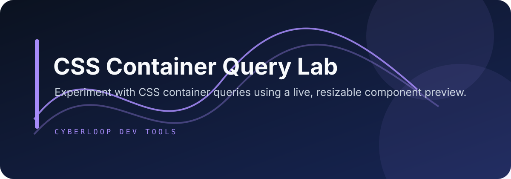

<div align="center">


<a href="https://github.com/CyberLoop-dev/css-container-query-lab">
  
</a>

<p><strong>Experiment with CSS container queries using a live, resizable component preview.</strong></p>

[](LICENSE)
[](https://github.com/CyberLoop-dev/css-container-query-lab)
[](https://github.com/CyberLoop-dev/css-container-query-lab/stargazers)
[](https://github.com/CyberLoop-dev/css-container-query-lab/commits/main)



</div>

## ✨ Overview

Experiment with CSS container queries using a live, resizable component preview. **CSS Container Query Lab** is a small, focused Node.js + browser JavaScript project designed to be easy to inspect, run, and extend. It works locally and keeps the workflow straightforward.

## 🚀 Features

- ✨ 📐 Resize a component container independently of the viewport.
- ✨ 🎚️ Adjust the query threshold with a live slider.
- ✨ 🧩 Inspect the exact CSS generated for the active threshold.
- ✨ 📱 See the component switch layout when its own container becomes wide.

## 🖥️ Demo

Run `npm start` and open the local page. Move the container-width and threshold sliders to see the card switch between stacked and horizontal layouts.

## ⚡ Quick Start

```bash
npm start
```

See the command-specific notes below if the project needs an input file or a browser tab.

## 🧰 Tech Stack

- **Primary language:** Node.js + browser JavaScript
- **Runtime:** Free, locally installed tooling
- **Dependencies:** Minimal; see the manifest in this repository

## 📁 Folder Structure

```text
css-container-query-lab/
├── assets/
│   └── overview.svg
├── README.md
├── LICENSE
└── source files and project manifest
```

## 🗺️ Roadmap

- [ ] Add named-container examples.
- [ ] Add size and style query presets.
- [ ] Export a complete HTML snippet.

## 🤝 Contributing

Issues and pull requests are welcome. Keep changes focused, document behavior, and add tests for new parsing or transformation rules.

## 📄 License

Released under the [MIT License](LICENSE).

<div align="center">
  
</div>
